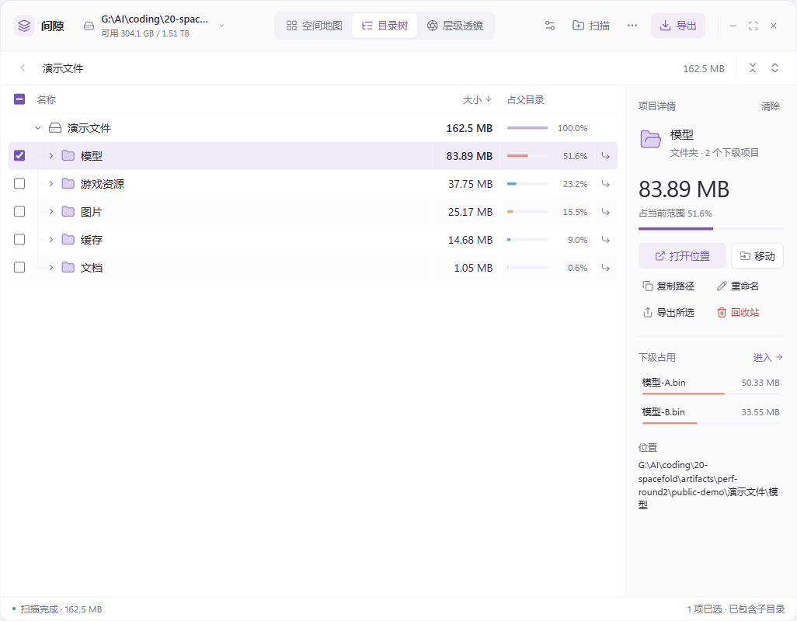
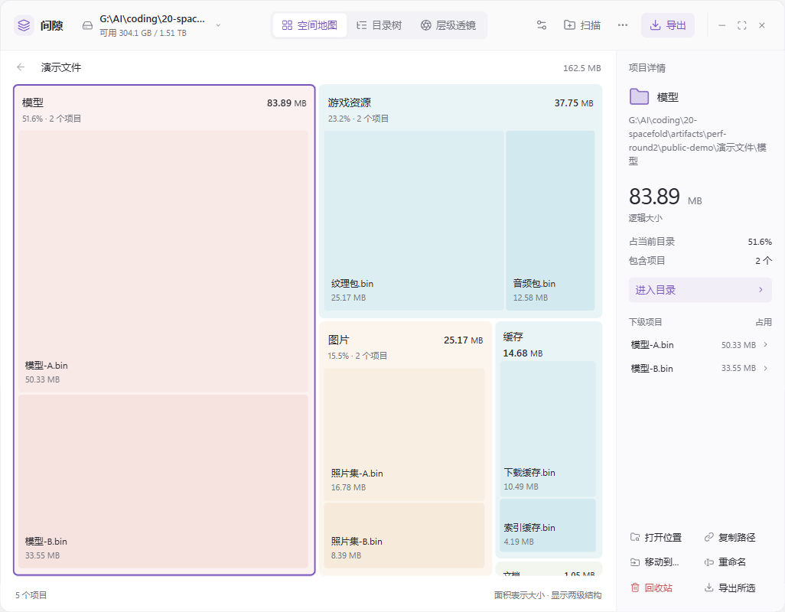
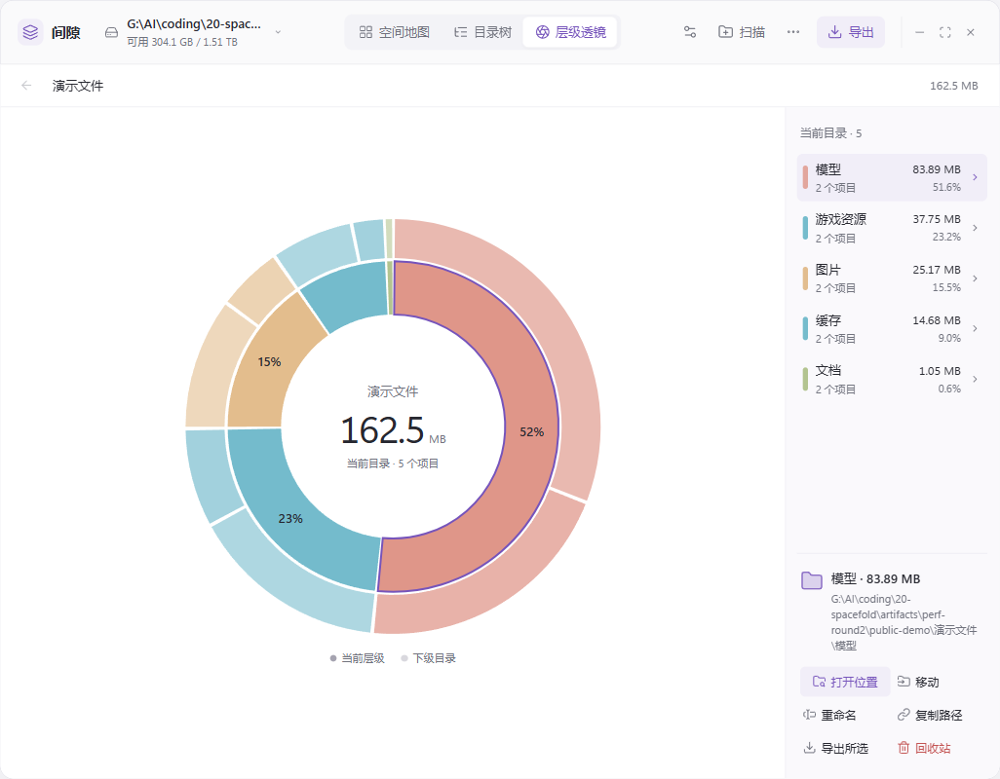

# 间隙 Spacefold

离线 Windows 磁盘空间分析工具。扫描目录后，用**目录树、空间地图、层级透镜**查看同一份结果，在右侧定位文件、管理文件和导出报告。

[下载最新版本](https://github.com/qing-yi-5427/Spacefold/releases/latest) · [验收记录](docs/acceptance.md) · [性能实测](docs/performance.md)

## 下载与运行

面向 Windows 11 x64，Release 同时提供两种版本：

| 版本 | 使用方式 |
|---|---|
| 安装版 `Spacefold_0.1.1_x64-setup.exe` | 双击安装，建立常规程序入口；缺少 WebView2 时通过微软官方引导程序下载运行依赖，首次可能需要联网。 |
| 便携版 `Spacefold_0.1.1_x64-portable.zip` | 完整解压到本地磁盘后运行 `Spacefold.exe`；包内随附官方固定版 WebView2，免安装。不要单独移走 exe 或删除运行依赖目录。 |

0.1.1 安装版约 **4.3 MiB**；便携版约 **302.1 MiB**，包含完整 WebView2 155.0.4283.45 x64。下载页附 `SHA256SUMS.txt`。可用 PowerShell 的 `Get-FileHash -Algorithm SHA256 <文件路径>` 对照校验。

便携版表示免安装；扫描数据库与设置仍保存在当前用户的 `%APPDATA%\com.spacefold.desktop`，便于重启恢复。扫描按当前用户权限执行。

固定版运行组件需随新版发行包更新，不自动更新；按[微软分发文档](https://learn.microsoft.com/en-us/microsoft-edge/webview2/concepts/distribution#the-fixed-version-runtime-distribution-mode)，不支持从网络位置/UNC 启动便携程序。

## 三种视图

下面是 Windows WebView2 应用实际截图，使用专门新建的演示文件夹扫描；文件名和分布为测试夹具，不是用户个人文件。

**目录树**：逐级展开、排序、多选，右侧查看所选对象及操作。



**空间地图**：按占用面积查看目录和文件，支持下钻与返回。



**层级透镜**：用旭日图观察层级关系与空间分布。



## 已有能力与边界

- 目录扫描、实时进度与取消、错误/部分结果记录、重启恢复；名称/路径搜索、类型和大小筛选。
- 关联打开、资源管理器定位、路径复制、属性，以及复制、移动、重命名和回收站操作；执行前确认计划并重新核验对象身份，结果逐项显示。
- CSV、XLSX、JSON、HTML 报告；导出范围和是否包含下级可独立选择。
- 五种强调色、明暗/系统主题、GB/GiB 单位、默认视图与窄窗口操作抽屉。

默认按逻辑大小统计，硬链接按目录项累计；已分配大小单独展示，无法测量的值保留为未知。扫描合计不等同于磁盘已用空间，未读取内容、链接与云目录覆盖边界会明确记录。取消批量文件操作可能保留已经完成的项；回收站失败不会回退到永久删除。

本机 SSD 五轮扫描对照的 0.0x 秒中位差按用户要求接受为“基本持平”；不据此宣称全面快于其他工具。真实扫描、完整收尾、GUI 内存与百万合成数据库分别记录，准确数字和构建归属见[性能实测](docs/performance.md)。HDD、实际云占位、断网/断卷等仍有[未验证边界](docs/acceptance.md)。历史比较、暂停续扫、硬链接去重、计划扫描和其他平台属于后续范围。

## 从源码构建

需要 Node.js 24、Rust stable MSVC、Visual Studio 2022 Build Tools（C++ 桌面开发和 Windows SDK）。

```powershell
npm ci
npm run tauri dev
# 检查和生产构建
npm test
cargo test --locked --manifest-path src-tauri/Cargo.toml
npm run tauri build
```

`scripts/package.ps1` 提供成品打包入口。锁文件随源码提交；生产界面内嵌，不需要运行开发服务器。CI 只检查与构建，不自动发布 Release。

设计与实现依据：[功能/技术需求](spacefold-features-tech.md)、[UI 规范](spacefold-ui-spec.md)；两份原始文档保留不改。[扫描优化交接](docs/performance-handoff.md)记录策略、证据与撤回实验。`artifacts/` 是本机测试输出，未随 Git 上传；重现脚本在 `scripts/`。

Spacefold 使用 [MIT License](LICENSE)；依赖及版权声明见[第三方组件](docs/third-party.md)和 [THIRD-PARTY-LICENSES.txt](THIRD-PARTY-LICENSES.txt)。使用或再分发随包的 WebView2 时须遵循 [Microsoft 固定版许可](docs/licenses/WebView2-Fixed-License.html)。

WebView2 包含 Microsoft Defender SmartScreen，可能按[微软隐私声明](https://aka.ms/privacy)及 [Edge 隐私说明](https://learn.microsoft.com/en-us/microsoft-edge/privacy-whitepaper#smartscreen)向微软发送相关信息；这是运行组件的行为，磁盘分析在本机完成。
