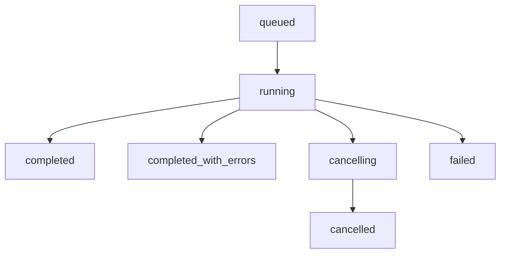
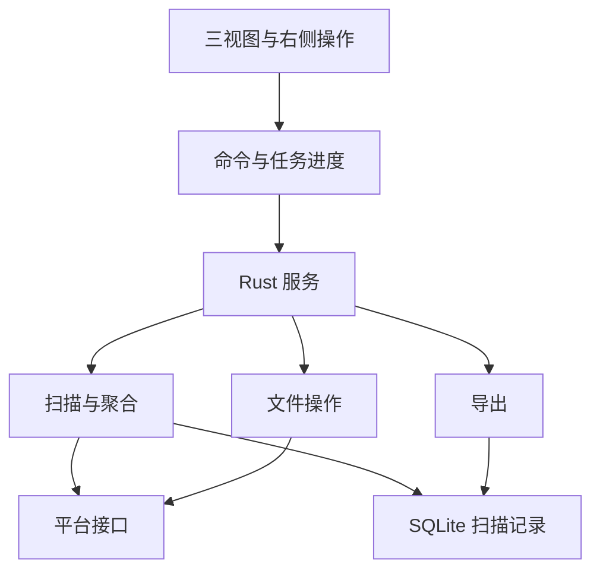

# 间隙 Spacefold：功能需求与技术实现路线

版本：1.0 · 2026-10-11  
读者：负责把 UI 原型实现为可用桌面软件的开发 Agent  
配套材料：`spacefold-ui-spec.md`《UI 设计与复刻规范》，其中附有最终 `spacefold-right-pane.html` 的完整源代码。

## 0. 先读这一页

要实现一个能扫描磁盘或指定目录、准确解释文件占用、提供三种联动视图、执行常见文件操作、导出多种格式报告的桌面应用。中文名称暂定“间隙”，英文工程名 Spacefold。

**已经确定的产品要求：**

1. 同时保留“空间地图”“目录树”“层级透镜”三个视图。目录树必须是真正可展开、可多选的层级结构。
2. 默认紫色，设置中可切换紫、蓝、青、橙、玫红五种强调色。界面强调色与目录分类色分别管理。
3. 桌面布局的详情、选中汇总和文件操作放在右侧：常规宽度 220 px，640–800 px 窗口下为 204 px，低于 640 px 使用右侧抽屉。不要重新增加一条位于主内容下方的批量操作区，也不要恢复 Finder 式常驻左侧栏。
4. 文件操作与四种导出必须最终接入真实系统能力。现有原型中的扫描、移动、回收站、导出均是演示，不能作为这些功能已完成的证据。
5. 本文决定“功能做什么、数据表示什么、程序如何组织”；外观尺寸、间距、颜色、控件状态以配套 UI 文档为准。

**建议的首发范围：Windows 11 x64 桌面端，Tauri 2 + React / TypeScript + Rust。** 这是为尽快交付提出的工程选择，不代表用户要求软件只能运行在 Windows。扫描和系统操作必须经过平台接口，为后续 macOS / Linux 保留实现空间；首版不同时承诺三个系统完全等价。

产品首先让用户完成四个动作：选择位置并扫描 → 看清大目录和文件 → 定位或处理项目 → 保存扫描结果。首版离线可用，不依赖账号或服务端。

## 1. 范围与优先级

P0 是首个可交付版本必须完成的闭环，P1 是闭环稳定后的增强。这里的 P0 不是“把所有系统优化一次写完”。

| 编号 | 功能 | 优先级 | 完成定义 |
|---|---|---|---|
| F01 | 扫描磁盘 / 指定目录 | P0 | 原生选择器及路径输入；可重新扫描完整来源或当前子目录；显示来源、开始时间和状态 |
| F02 | 真实扫描进度 | P0 | 显示已发现项目、已统计字节、耗时、错误数；可取消并查看已完成部分 |
| F03 | 大小与元数据 | P0 | 逻辑大小、文件 / 目录计数、类型、修改时间；能测得时显示已分配大小，不能测得明确标记 |
| F04 | 三视图联动 | P0 | 共用扫描、浏览范围、主要选中项、排序和计量口径；切换视图不重新扫描 |
| F05 | 目录树浏览与选择 | P0 | 展开 / 收起、同级排序、单选、复选框多选、范围选择、键盘导航、右侧批量操作 |
| F06 | 查询与筛选 | P0 | 名称 / 路径关键词、文件类型、大小下限；结果能定位回原目录；没有结果时不丢失原始扫描 |
| F07 | 查看与定位 | P0 | 打开文件 / 文件夹、在资源管理器中定位、复制路径、显示属性 |
| F08 | 文件管理 | P0 | 复制、移动、单项重命名、批量移入回收站；冲突与部分失败逐项说明 |
| F09 | CSV / XLSX / JSON / HTML | P0 | 四种均生成真实有效文件；支持导出范围、是否包含下级和字段选择 |
| F10 | 本地扫描记录 | P0 | 当前扫描持久化，重启后可查看最近一次结果；未完成与已完成记录分开 |
| F11 | 设置 | P0 | 五种强调色、跟随系统主题、容量单位；记住最近扫描来源及用户选择的默认视图 |
| F12 | 扫描增强 | P1 | 暂停 / 继续、多个历史扫描、结果比较、排除规则、拖放目录、计划扫描 |
| F13 | 更深分析 | P1 | 硬链接去重统计、按文件类型 / 日期着色、变化排行、导入完整扫描快照 |
| F14 | 平台与扫描提速 | P1 | macOS / Linux 平台实现、网络盘体验优化、经验证后的 NTFS 专用扫描后端 |

暂不纳入首版：重复文件内容去重、AI 自动清理、系统优化、注册表清理、恢复已删除文件、文件内容索引、云服务账号接入。它们不应挤占磁盘分析、操作与导出的开发时间。

普通用户权限下可完成扫描；权限不足的目录形成可见错误。首版不自动提权、不自动改变目录权限。已挂载且可访问的盘符 / UNC 路径按通用目录接口尝试读取，但网络波动、云盘和特殊文件系统的能力按实际探测结果显示。

### 原型未绘制、P0 仍须补全的入口

原型是视觉与交互基准，不是完整功能目录。下列功能已经列入本文件的 P0，但当前原型尚未画全；开发时在既有区域补齐，沿用 UI 文档的组件样式，不扩展主导航。

| 功能 | 正式版入口与位置 |
|---|---|
| 搜索 / 筛选扫描结果 | 位置菜单增加“搜索扫描结果…”，快捷键 Ctrl+F；主分析区切换到结果列表，右侧详情和动作继续使用 |
| 系统关联打开 | 文件菜单增加“打开”；目录在资源管理器打开，文件由系统关联处理 |
| 复制文件 | 文件菜单增加“复制到…”并选择目标，与已有“复制路径”分别命名 |
| 容量单位 / 完整设置 | 外观浮层增加“更多设置…”进入统一设置对话框，容纳 GB / GiB、主题与默认视图；五色选择区域保持紧凑 |
| 最近扫描 / 历史恢复 | 现有位置弹层中显示最近扫描记录及时间，点击载入已保存结果，并展示过时 / 不完整状态 |

外观弹层和位置弹层可通过同样风格的次级内容承载这些功能。新增入口不能改变“三视图 + 右侧操作”的总体布局。

## 2. 浏览、选择与状态的一致性

### 2.1 分清四类状态

| 状态 | 含义 | 典型变化 |
|---|---|---|
| `scanId / revision` | 哪次扫描、哪个数据版本 | 重扫、刷新、文件操作后的数据修订 |
| `scopeId` | 当前浏览的目录 | 进入子目录、面包屑返回、点击图心返回 |
| `primaryId` | 右侧当前重点展示的项目 | 单击树行、矩形、圆弧或列表项 |
| `selectedIds` | 文件操作针对的显式选择集合 | 复选框、范围选择、清空选择 |

悬停、键盘焦点和图形预览高亮是独立的临时状态，不得偷偷更改文件操作对象。当前目录总大小始终指向 `scopeId`；右侧所选大小指向选择集合；层级透镜的图心始终表示当前目录。

### 2.2 统一选择规则

- 点击项目进行单选；进入目录是另一个明确动作。目录树双击目录名称只展开 / 折叠分支，scope 不变；地图和透镜双击目录才下钻。树的行末进入按钮与右栏“进入”改变 scope。树中文件名双击执行“打开所在位置”。键盘 Enter 激活当前焦点按钮；生产 treegrid 另补左右展开 / 折叠、上下移动及 Space 选择，不把所有 Enter 都解释成打开文件。
- 复选框用于多选。父目录代表整个目录对象；同时选择父目录和其后代时，操作和容量汇总先移除被父目录覆盖的后代，形成规范化集合。
- 规范化依据扫描中的祖先关系和节点身份，不能靠字符串 `startsWith` 判断路径。例如 `D:\Data` 不是 `D:\Database` 的父目录。
- 同一目录中按当前列排序，默认大小降序，大小相同时按名称和稳定 ID 决定顺序。扫描进行中不持续打乱用户正在操作的行，按批次更新并保留锚点。
- 树中的多选可以在图形视图中保留；图形以 `primaryId` 展示一个重点对象。只切换视图不丢多选；在图形中显式选中另一个项目则建立新的单选，避免右侧仍对隐藏的旧集合执行操作。
- 切换到目录树时展开主要选中项的祖先，并滚动到可见位置。切换到图形时，以选中项所在的合适父目录作为显示范围；状态规则与 UI 文档保持一致。
- 所有操作入口，包括右侧、右键菜单、顶部菜单和快捷键，都调用同一个选择解析与操作服务。

### 2.3 筛选含义

关键词、类型和大小筛选作用于扫描记录，不重新遍历磁盘。目录树保留命中项的祖先以说明路径；这些祖先可以显示为“路径上下文”。P0 筛选只改变结果列表，图形的范围、总数和配色不暗中变化。用户点击“在目录中查看”后退出搜索结果，跳转至相应范围。

导出弹窗必须明确写“完整扫描 / 当前目录 / 已选项目”，不要用含糊的“导出当前”。如果后续增加“仅导出筛选结果”，它必须是一个独立且可见的范围选项。

## 3. 文件大小的语义：必须在写扫描器前确定

### 3.1 首版默认口径

默认用**逻辑大小**排序和布局：文件记录文件逻辑长度；目录记录其可读取后代文件的逻辑长度之和。按目录项累计，因此同一个底层文件的多个硬链接可能在不同目录中重复计数。界面和导出元数据必须写明这一口径。

**已分配大小**是另一个字段，表示平台能确认的占用度量。P0 可在详情中展示，只有支持完整、统一口径时才允许切换为图形主指标。读取失败、平台不支持与确实为零必须区分，不能全部写成 `0`。

Windows 的 `FILE_STANDARD_INFO` 提供 `AllocationSize` 与 `EndOfFile`；压缩、稀疏、云占位等文件需要结合其元数据核验。`GetCompressedFileSizeW` 不能独自充当所有文件的通用已分配大小实现。[T10][T11]

| 数据 | 展示 / 计算规则 |
|---|---|
| `logicalBytes` | 文件本身的逻辑长度；目录本身不重复装入后代总量 |
| `logicalTotalBytes` | 当前节点的递归逻辑总量，树与图形共用 |
| `allocatedBytes` | 单项已测得值或 `null`，附测量方法与可信状态 |
| `allocatedKnownTotalBytes` | 已测得部分的小计；只要存在未知项就标“部分统计” |
| 硬链接去重总量 | P1 独立指标，以卷身份 + 文件身份去重，不伪装成每条路径独占的空间 |
| 可释放空间 | 首版不做保证值；不能直接把逻辑大小或已分配小计当作删除后一定能释放的字节 |

目录总量为后代合计；导出包含目录和子文件时，不能再把所有行的目录合计与文件大小直接相加。没有权限读取的目录显示“部分统计 / 无法读取”，不能显示成“空目录”。P0 默认统计文件的主数据流；尚未实现的备用数据流（ADS）、目录索引和文件系统元数据在计量说明中列明，不能声称已枚举整卷全部物理占用。扫描中图形只根据已知合计计算，标出“已扫描部分”。

### 3.2 文件系统边界

- **硬链接**：保存平台文件身份和链接数；路径视图允许多处出现，去重统计另算。只删除一个链接未必释放底层内容。[T12]
- **符号链接、junction 和挂载点**：先识别链接自身和 reparse tag，默认不递归跟随目录跳转。记录链接类型与目标提示。后续开放跟随时必须限制扫描边界，并使用文件系统身份防环。[T12][T13]
- **云占位文件**：不能把所有 reparse point 都当作目录链接跳过。识别占位状态，仅读元数据，不为统计体积主动读取文件内容或调用 hydration；逻辑大小与本地占用分别表示。部分云目录的枚举也可能请求远端信息，严格本地扫描应采用可用的本地条目枚举策略或跳过需召回目录，并标“云目录未完整扫描”。不能同时保证第三方云目录完整枚举且绝不访问远端。[T13][T14][T23]
- **压缩 / 稀疏文件**：逻辑长度可能远大于实际分配。专门测试，不能使用“文件大小向簇大小取整”替代平台查询。
- **权限 / 占用 / 消失的文件**：记下错误代码、节点、阶段和数量；继续扫描其他位置。扫描过程不是整个文件系统的原子快照，文件可能边扫边变化。
- **长路径与字符**：Rust 内部使用 `PathBuf / OsString`，不要强制把原始路径转成 UTF-8；Windows 平台层处理宽字符、长路径和 UNC，并正确声明 `longPathAware`。展示字符串与操作路径分开，操作只使用后端保存的原始路径。Shell 与文件系统 API 的长路径支持分别验收；扫描成功不代表原生 Shell 一定能回收，失败时保持明确错误，不改用永久删除。[T09][T24]
- **大小写**：不要对全部路径无条件转小写做身份键。大小写语义以文件系统实际行为为准；使用节点 ID 和平台文件身份。

操作系统容量与扫描总量分开显示。磁盘空间还受权限、文件系统元数据、保留空间、共享块、硬链接、配额等影响。`GetDiskFreeSpaceEx` 返回的字段存在调用者配额语义，不能把不同分母的 total / free 字段随意相减后宣称为全卷使用量。[T15]

## 4. 扫描任务与数据流水线

建议流水线为：枚举目录 → 查询条目元数据 → 标准化节点 → 批量写入存储 → 由叶到根更新汇总 → 向前端发送状态 / 可见范围失效通知。

### 4.1 任务生命周期



这些是数据状态，不要求在 UI 同时展示所有英文名。`cancelled` 仍可打开已完成部分；`failed` 表示扫描来源或存储等关键环节失败。单个拒绝访问不能让全盘任务变成失败。

取消后停止安排新任务，通知已有任务结束，刷出已完成批次，保存“不完整”状态。不能一点击取消就把仍有系统调用运行的任务标为彻底结束。遇到网络文件系统阻塞时，界面继续响应，显示“正在停止”，待平台请求返回或取消完成；必要时把网络扫描放独立 worker 进程中处理，不能只增加线程掩盖卡住的问题。

普通目录扫描事先不知道总项目数，进度采用已发现项、已统计字节和当前阶段。不要把已统计字节除以整卷已用空间当百分比，也不要伪造线性进度条。扫描完成后再稳定显示最终排行。

### 4.2 并发和规模

- 使用有界任务队列和固定上限的元数据工作池。以少量并发起步，按 HDD / SSD / 网络路径的实测结果调整；不要为每个文件启动一个异步任务。
- 阻塞文件系统调用放阻塞工作池或专用线程，不能占用 UI 线程或把它误当作不会阻塞的 `async` 函数。
- SQLite 单写入者，扫描数据按批次落库；独立读连接服务 UI 查询。SQLite 允许多个读事务，但同一时刻只有一个写事务。[T05]
- 建议初始批次为 500–2,000 节点或 50–100 ms，以先达到者触发；这些是待实测的起点，不是性能结论。
- 前端只拿到可见列表页和图形所需的局部层级。后端不通过 IPC 推送整个百万节点树，前端不维护第三份完整节点数组。
- 给扫描队列、待写批次、节点缓存和图形请求设置独立上限；超出预算时减速或落盘，不能静默丢项目。
- 根目录下的直接文件也必须计入。空间地图可用“本目录文件”作为图形分组节点，但它是虚拟分组，不能被当作真实文件夹执行移动或删除。

局部刷新使用新 `revision`：先将目标子树标为更新中，重扫并原子替换该子树，再更新祖先汇总。用户看到旧值时明确其更新时间，避免半新半旧的结果假装已经一致。

## 5. 推荐技术架构

### 5.1 技术选择与取舍

| 部分 | 建议 | 理由 / 边界 |
|---|---|---|
| 桌面容器 | Tauri 2 | Rust core 负责系统能力，系统 WebView 负责 HTML/CSS；适合复用已经确定的 UI。[T01] |
| UI | React + TypeScript + Vite | 按 UI 文档拆组件，CSS 自定义变量管理主题；不要让现成组件库覆盖既定外观 |
| 目录树 | 自有层级状态 + TanStack Virtual | 只渲染视口行；虚拟化库解决渲染范围，不替你定义树、选择和键盘语义。[T08] |
| 图形布局 | 可测试的纯布局函数；必要时使用 d3-hierarchy | treemap / partition 只计算坐标，绘制风格按原型；D3 支持对应层级布局。[T07] |
| 扫描 / 聚合 / 查询 | Rust | 平台路径和整数处理留在后端，核心模块可独立测试 |
| Windows 系统层 | Win32 / Shell API，经薄封装暴露 | 分离枚举、元数据、系统打开、回收站、复制移动等能力 |
| 持久化 | SQLite + 小型设置文件 | 节点查询、任务恢复和扫描记录落数据库；设置用版本化 JSON / Store 即可 |
| 导出 | Rust writer | CSV / JSON / HTML 流式写入；XLSX 可选 `rust_xlsxwriter` 的低内存模式。[T16] |

Tauri 使用操作系统提供的 WebView；Windows 使用 WebView2、macOS 使用 WKWebView、Linux 使用 WebKitGTK。因此不能把“一套 HTML”理解为“各系统一定像素完全一致”。首发要在目标 Windows WebView2 中做视觉验收。[T01]

Electron 也能复用这套前端，且沿用 Chromium 多进程模型；如果团队主要熟悉 Node / Electron，可更换桌面外壳，Rust 扫描器仍可作为独立模块或进程保留。Qt Quick 则使用 QML 和 C++ 扩展，适合已有 Qt 工程，但需要重新实现当前 HTML/CSS 表达。本项目暂选 Tauri，目的是减少 UI 重做并清晰分离扫描核心；本文没有测量三者的启动时间或内存，不作数值优劣承诺。[T17][T18]

### 5.2 模块边界

| 模块 | 职责 | 不应承担的工作 |
|---|---|---|
| `frontend/workspace` | 视图、选择、弹窗、快捷键、可见数据缓存 | 遍历本地文件、解释系统错误、直接执行删除 |
| `commands` | 校验 IPC、调度服务、统一错误 DTO | 包含整套扫描算法 |
| `scan_core` | 调度、聚合、取消、完整性标记 | 依赖 React 或窗口对象 |
| `platform` | 枚举、文件身份、路径、元数据、原生操作 | 改写 UI 选择状态 |
| `repository` | 扫描记录、节点分页、索引、事务、迁移 | 替文件操作成功与否作判断 |
| `file_ops` | 计划、重验证、执行、逐项结果、刷新请求 | 只凭过期扫描路径直接修改文件 |
| `export` | 范围解析、格式 writer、完整性与取消 | 从 DOM 文本或屏幕表格拼出“扫描结果” |

模块调用关系如下；数据库中的扫描记录是分析与导出的共同数据源，系统文件操作始终经过平台层。



应用只载入打包前端资源；文件名、路径、错误文本均按不可信文本处理。Tauri capabilities 约束窗口和插件权限，但不能替代 Rust command 内部校验；官方文档也说明自定义 command 的允许范围与核心代码安全需要开发者自行正确配置。[T03]

## 6. 数据模型与 IPC 合约

### 6.1 最小数据模型

`Scan`：`scanId`、`schemaVersion`、`rootId`、来源原始路径引用、展示路径、平台、开始 / 结束时间、状态、扫描选项、指标口径、错误计数、`revision`。

`Node`：`nodeId`、`parentId`、名称、原始路径引用、类型、扩展名、逻辑大小、逻辑递归合计、已分配值及完整性、文件 / 目录计数、修改时间、平台文件身份、链接属性、错误状态。

`Operation`：`operationId`、类型、计划版本、规范化来源节点、目标位置、冲突策略、开始 / 结束时间、逐项结果、相关扫描需要刷新的子树。

`Node` 的文件身份允许暂缺：快速枚举未取得身份时，选择 / 计划操作阶段补采，并比较扫描时的类型、时间与大小等 fingerprint；执行前复核当前身份。不能为了字段看起来齐全就写入伪身份，也不能把一个平台 ID 当成永久不会复用的身份凭证。[T25]

基本索引围绕 `(scanId, nodeId)`、`(scanId, parentId, sortKey, nodeId)` 与错误记录建立。按父节点分页，不每次查完整扫描再筛选。原始路径可用父子名称段与必要缓存保存，避免为百万节点重复保存多份长绝对路径。

字节不使用浮点存储：Rust 用非负整数，聚合使用检查溢出的加法；所有字节和可能超出 JavaScript 安全整数的 ID / 计数经 IPC、JSON 导出时使用十进制字符串。前端比较与精确计算用 `bigint`，只有绘图比例转换为有限的 `number`。SQLite `INTEGER` 是有符号整数，写入时检查范围；超出支持范围明确返回 `SIZE_OUT_OF_RANGE`，不得回绕或转浮点后静默损失精度。[T06]

原始路径是后端数据，前端只得到 `nodeId` 和可展示字符串。Rust `OsStr` 能表达非 UTF-8 系统字符串，不能把 `to_string_lossy()` 得到的展示文本重新当作操作路径。[T09]

若原始名称无法无损表达成 Unicode，JSON 需附 `pathEncoding / pathData` 等编码字段保留原始路径字节 / Windows 宽字符，另给 `displayPath`；CSV / XLSX / HTML 使用展示文本并注明替代情况，不承诺这些展示格式可还原操作路径。

### 6.2 建议 IPC

```ts
type ByteCount = string; // 非负十进制整数
type NodeRef = { scanId: string; nodeId: string };

type WorkspaceState = {
  scanId: string | null;
  revision: number;
  view: 'tree' | 'map' | 'lens';
  scopeId: string | null;
  primaryId: string | null;
  selectedIds: string[];
  metric: 'logical'; // P0 默认；其他口径启用时扩展
};

type AppError = {
  code: string;             // 可机器判断，不能只有一段文案
  message: string;          // 面向用户
  retryable: boolean;
  nodeId?: string;
  osCode?: number;
};
```

| Command | 输入 / 输出要点 |
|---|---|
| `choose_scan_source` | 原生选择器；返回后端保存的来源引用和展示文本 |
| `start_scan` | 来源、选项 → `scanId`；立即返回任务引用 |
| `cancel_scan` | `scanId` → 接受取消；最终状态通过任务流返回 |
| `get_children` | 节点、排序、过滤、游标、页大小、revision → 一页节点及后续游标 |
| `get_ancestors` | 节点 → 面包屑及需展开的祖先 |
| `get_chart_data` | 范围、深度、节点预算、revision → 局部层级与聚合余项 |
| `get_selection_summary` | 来源节点集合 → 去除祖先覆盖后的项目、总量和可执行动作 |
| `plan_operation` | 操作类型、节点引用、expectedRevision、目标、冲突策略 → 可审阅计划及逐项限制 |
| `execute_operation` | `planId` → `operationId`；重新验证后执行 |
| `start_export / cancel_export` | 扫描版本、范围、字段、格式、目标文件 → 导出任务 |
| `get_recent_scans / load_scan` | 恢复本地结果；返回完整性与是否已过时 |
| `read_settings / update_settings` | 版本化设置，校验枚举值并原子保存 |

命令接口用 Tauri `invoke`；扫描 / 操作 / 导出的持续进度采用 `Channel`。官方推荐 Channel 用于流式数据；应用仍需自行做有界缓冲与批量发送，不能假设 IPC 自动解决生产速度大于消费速度的问题。[T02]

消息必须有 `jobId`、`scanId`、`revision`、递增 `seq` 和消息类型。前端丢弃过期任务消息；同一查询若 revision 已变化，返回 `REVISION_CHANGED` 并重新拉取，不拼接不同版本的分页结果。列表更新可发“哪些范围失效”，不逐文件触发全局 React 更新。

`selectedIds` 用于普通小集合；“选择全部结果”等大集合使用后端生成的选择引用及排除项，执行时解析为固定 revision 下的集合，不把百万个 ID 塞进一次 IPC。页大小和 IPC 载荷都在后端限制。

## 7. 文件操作：从计划到真实结果

### 7.1 所有写操作走同一条链路

1. 前端提交选中的节点引用和动作；后端规范化父子重复选择，检查动作是否适用。
2. 后端读取当前文件身份与属性，检查来源仍存在、目标不是其自身或后代、冲突策略明确，生成短期有效的操作计划。
3. UI 展示名称 / 数量 / 目标 / 冲突处理；需要确认的操作在这一处确认，不额外堆叠多次相同弹窗。
4. 执行前再次核验来源身份、父路径的链接状态与目标位置。原路径已被另一个文件替换、父目录被换成 junction、文件类型变化、目标发生冲突时，停止该项并返回具体原因。验证与系统操作之间仍可能发生竞争；这是一套减少竞态的策略，不是整个文件系统的原子保证。无法可靠复核的破坏性操作保守拒绝该项。
5. 调用原生 API，接收逐项成功、失败、跳过、取消结果。
6. 保存操作日志；将受影响子树标记为待刷新，局部扫描后修订数据库和祖先合计。

不要把路径字符串拼成 PowerShell / shell 命令；不要只根据旧扫描记录判断操作成功。文件操作期间发生变化是正常边界，应当有 `SOURCE_CHANGED`、`DESTINATION_CONFLICT`、`ACCESS_DENIED`、`FILE_IN_USE`、`NOT_FOUND`、`CANCELLED` 等稳定错误码。

### 7.2 每项功能的行为

| 动作 | 行为约束 |
|---|---|
| 打开 / 定位 | 调用系统关联或资源管理器定位；批量“打开文件”不默认同时启动大量程序 |
| 复制路径 | 单项完整路径；多项换行分隔；“复制路径”与“复制文件”是不同动作 |
| 属性 | 右侧展示扫描属性，原生属性可作为单项菜单入口；标明更新时间 |
| 重命名 | 首版单项；保留扩展名可编辑但明确提示；校验非法名称、同名目标及仅大小写变化 |
| 复制 / 移动 | 明确目标位置；冲突选择“跳过 / 保留两者 / 替换”；默认不替换；跨卷移动按系统能力处理 |
| 回收站 | 默认删除路径；Windows 使用支持回收站语义的 Shell 操作，并检查每项结果和取消状态 |
| 永久删除 | P0 不放入主流程；未来若提供，必须是独立命名动作和独立确认 |

回收站不可用、网络位置不支持、系统要求永久删除或操作被取消时，**不得静默降级为永久删除**。Windows 在正确的 COM 线程使用 `IFileOperation`，设置并核验 `FOFX_RECYCLEONDELETE`，保留必要系统确认，不设置会一概同意所有对话框的 `FOF_NOCONFIRMATION`。结合逐项回调和 `GetAnyOperationsAborted` 判定结果；不能只看排队成功或 `PerformOperations` 返回成功就认为所有项目均已完成。必须用真实 Windows 测试验证回收站不支持和超大文件等情形，不能只凭一个 flag 宣称保证。[T19]

扫描根目录、虚拟分组节点的移动 / 重命名 / 删除禁用；多选时禁用只适用于单项的动作。文件夹父子混选只操作上层目录一次。跨卷移动不是可以随时整体回滚的单一步骤，取消可能留下部分完成项；报告真实结果，重试只针对失败或未完成部分。不要虚构一个能够撤销所有文件操作的统一“撤销”按钮。

批量回收站汇总显示“选中项目的逻辑大小”，不能提前显示“将释放 X GB”。完成后重新查询磁盘空间，也不能把同期其他软件的写入变化全都归因于本次操作。

## 8. 导出：范围、精度、真实文件

### 8.1 范围规则

| 范围 | 不包含下级 | 包含下级 |
|---|---|---|
| 完整扫描 | 扫描根的直接子项 | 扫描根的全部后代 |
| 当前目录 | 当前目录的直接子项 | 当前目录的全部后代 |
| 已选项目 | 规范化后的选择项本身 | 规范化选择项及其全部后代 |

根目录 / 当前范围本身记录在报告元数据中，避免默认把它再输出为可相加的数据行。“完整扫描”意味着完整扫描范围，不意味着扫描已成功读取了所有内容；`scanStatus` 和错误数量必须保留。

统计合计按规范化范围计算，不是直接 `SUM(每一行 size)`。示例数据中 Checkpoints 168 GB 与 Games 218 GB 合计为 386 GB；再选 Checkpoints 内文件，合计仍是 386 GB。选中这两个目录递归导出是 9 条记录，直接导出是 2 条记录。导出预览与实际 writer 必须共用同一范围解析器。

### 8.2 字段与格式

基本字段：名称、展示路径、父路径、节点类型、深度、逻辑字节数、已分配字节数、修改时间。导出中的 `logical_bytes` 明确定义为节点递归合计，另提供 `own_logical_bytes`（文件本身大小，目录为 0），与内部的 `logicalTotalBytes / logicalBytes` 对应。建议扩展：节点 ID、父 ID、计量状态、链接类型、错误代码。用户可选报告字段，但报告元数据始终保留扫描时间、来源、单位、指标口径、范围和完整性。

| 格式 | 必须实现 |
|---|---|
| CSV | UTF-8，可提供适合 Excel 的 BOM；规范转义引号、逗号和换行；空值与 0 分开；采用下述显式元数据记录方案 |
| XLSX | 真正的 OOXML 工作簿；“概览”和数据工作表；冻结表头、筛选、合适列宽；字节原值写为文本单元格 |
| JSON | 带 `schemaVersion / metadata / rows` 的结构；字节和大整数为十进制字符串，未知为 `null` |
| HTML | 可离线打开的独立报告；概览、来源、统计口径、表格和完整性说明；转义所有文件名和路径 |

**CSV 单文件元数据方案固定如下：**`record_type` 和 `metadata_json` 是两列必需列，后面接用户选择的文件字段。第一条记录的 `record_type=metadata`，其 `metadata_json` 保存扫描来源、时间、状态、指标、范围、完整性、文本处理方式和记录总数；文件字段留空。后续记录 `record_type=entry`，填写文件字段，`metadata_json` 留空。所有行使用同一表头和列数；元数据 JSON 是按 CSV 标准转义的一格文本，不插入注释或非表格前言。消费者按 `record_type=entry` 读取文件条目，预览、合计和“导出 N 项”也只统计 entry。空结果可以只含元数据记录，因此仍能保存有意义的报告。此方案避免每行重复来源长路径，也不把元数据伪装成一个文件。

JSON 建议骨架：

```json
{
  "schemaVersion": 1,
  "metadata": {
    "product": "Spacefold",
    "scanStatus": "completed_with_errors",
    "metric": "logical_per_directory_entry",
    "scope": "selected",
    "recursive": true,
    "totalLogicalBytes": "386000000000",
    "errorCount": 2
  },
  "rows": []
}
```

这是格式示例，不是真实扫描结果。JSON 报告与可重新载入的扫描快照不要混为一谈：任意删减字段的报告不保证能还原整棵目录树。P1 如增加快照导入，规定完整必填结构、版本兼容、大小上限，并以只读状态打开；不得把导入文件中的路径直接授权为本机文件操作目标。

### 8.3 精度、安全与超限

文件名、路径等自由文本可能以 `=`、`+`、`-`、`@`、其全角变体或控制字符开头。CSV 的普通双引号转义不能单独消除电子表格公式解释风险；默认采用面向表格阅读的文本化策略，在报告元数据说明表示可能被改变。按 OWASP 指引处理前缀、分隔符和引号，并做目标表格软件测试；不存在对所有表格软件及反复保存 / 重开都成立的通用安全保证。需要无损原始数据时使用 JSON；XLSX 对此类值显式写字符串，不生成公式或外部链接。[T20]

Excel 单表最多 1,048,576 行，数字精度为 15 位，单元格文本最多 32,767 字符。XLSX 每张数据表最多 1,048,575 行数据，超出后自动拆表并保留总记录数；原始字节使用文本以保护精度，另可提供经过舍入的数值 MiB / GiB 列供分析。超过单元格文本上限等不能无损表示的情况，明确报格式限制并建议 JSON，不能悄悄截断。[T21]

CSV 被 Excel 自动识别为数字时仍可能失去精度，不能宣称 CSV 在所有表格软件里天然无损。HTML 对大规模报告设可配置记录预算；超出预算明确让用户缩小范围或改用 CSV / JSON，而非假装导出了全部数据。

### 8.4 导出执行

导出绑定固定扫描 revision，分页读取并流式写入临时文件。完成后关闭、校验文件结构，再原子替换为最终文件；失败 / 取消保留原目标文件并清理临时文件。保存位置冲突按原生保存对话框处理。

使用 SQLite 一致读事务或稳定扫描副本，不能边读取边混入不断变化的扫描行。若扫描中允许导出，先绑定明确的已提交部分及其状态；长读事务下控制 WAL / 临时磁盘预算，必要时从一致副本导出。导出进行中显示已写记录数、可取消。错误列表不能靠一个绿色 Toast 代替。`rust_xlsxwriter` 提供 constant-memory 模式，可作为大工作簿实现候选；需要按其行写入限制组织 writer，先验证再选定版本。[T16]

## 9. 持久化、配置与恢复

P0 在本应用的数据目录使用 SQLite 保存当前及最近完成扫描，维护 `schema_version`、任务状态与更新时间。若扫描来源包含本应用正在写入的索引 / 临时导出目录，应排除这些工作文件并在覆盖说明中记录，避免扫描器自己的增长持续影响结果。写入采用短批次事务；`running` 记录若在下次启动仍存在，应标记为“上次中断”，允许浏览已记录部分或重新扫描，不能假定还能从任意文件位置准确续扫。

完成扫描与扫描中记录分开。删除历史记录只删除本应用的索引数据，不处理原文件。读取旧记录时显示扫描时间；首次文件操作必须重新验证，不能把历史记录当作当前文件系统事实。

备份正在使用的 SQLite 数据库时使用 SQLite Backup API 或官方支持的方法；不要只复制主 `.db` 文件却遗漏其活动状态。官方 Backup API 能生成一致的数据库副本。[T04]

设置采用版本化结构：`accent`、`theme`、`sizeUnit`、`defaultView`、最近位置及最近导出格式。首版默认紫色、跟随系统主题；重启后保留用户选择。尺寸、分隔线拖动位置等布局状态与业务数据分开；未知 / 损坏设置回退默认，不导致扫描记录不可用。

容量单位默认十进制（GB = 10^9 字节），可切换二进制（GiB = 2^30 字节）；标签必须随实际换算改变，不能用 GB 标识 1024 进制。排序、合计和图形比例始终使用未舍入字节，展示层再格式化；切换单位不能改变面积或选中集合。

扫描记录和报告包含真实路径，全部按本地数据处理；诊断日志默认记录错误码和阶段，用户主动导出诊断时再选择是否包含路径。这是产品数据处理方式，不需要给正常扫描流程叠加无关提示。

## 10. 渲染与性能策略

目录树采用扁平可见行模型：展开集合决定哪些节点出现，后端分页保证单个巨型目录也不会一次加载全部子项。键盘上下移动以可见顺序计算；焦点项目被虚拟列表回收时仍应能恢复，不把焦点丢到窗口外。

空间地图和层级透镜共用真实层级与容量数据。只为当前范围请求有限层数和节点数；面积 / 角度按数值计算，不能用预设的 CSS 网格假装数据布局。若使用 D3 的递归 `sum`，只累加叶子 / 自身值，不再把目录递归总量与其子项重复相加；被截断层级的聚合节点作为已知权重的叶子。零大小项目保留在目录列表中；过小扇区 / 矩形合并为“其他 N 项”，合计必须守恒，聚合块不能直接执行文件操作。

先实现与原型一致、可测试的局部布局。树之外的图形可以采用 Canvas 绘制密集图元，DOM / SVG 负责有限标签、选中框和可访问操作入口；有限规模 SVG 也可用。选择取决于实测，不要求第一天同时实现两套渲染器。D3 的布局函数不决定 UI 外观，不能因为导入了一个默认图表就改变已确认设计。[T07]

点击 / 按下的反馈立即发生；长任务在后台进行。扫描数据更新限频，避免图形频繁洗牌。尊重 `prefers-reduced-motion`，停用非必要动画；支持键盘和屏幕阅读器操作等价的目录列表，不能让圆弧成为唯一入口。

下面是**开发验收预算，尚未实测**：

| 场景 | 初始目标 / 测量方式 |
|---|---|
| 交互反馈 | 本地状态反馈目标 ≤ 100 ms；录制操作与主线程长任务确认 |
| 扫描反馈 | 开始后尽快显示真实项目 / 阶段；不等待完整扫描后才展示整个界面 |
| 列表滚动 | 只挂载视口和少量 overscan 行；100 万节点记录下也不渲染百万 DOM |
| 缓存与扫描 | 100 万条合成元数据下，总工作集以可配置预算控制；先以 512 MiB 核心缓存预算起步，超出时降级 / 落盘 |
| 取消 | 本地正常 I/O 的取消响应目标 ≤ 1 s；阻塞系统调用单独记录实际退出时间 |
| 导出 | 百万条 CSV / JSON 持续流式输出，无一次性构建全文件字符串；XLSX 可分表并控制内存 |

扫描速度必须分别测试 HDD、SSD、网络目录、冷热缓存和文件数量，报告硬件及条件。不能写“几秒扫完整盘”这种未经测试的承诺。Windows 安装包还应测试 WebView2 缺失场景；Tauri 提供下载、嵌入及离线安装等选项，按发布方式选择。[T22]

## 11. 测试与验收清单

只为真实风险写测试，优先验证数据正确性和文件操作；单纯颜色调整不需要照抄实现写测试。

| 类别 | 必测样例 | 验收 |
|---|---|---|
| 聚合 | 空目录、0 字节文件、根下文件、深层目录、父子混选 | 各视图和导出总量相同，不重复计数 |
| 真实字节 | 超过 JS 安全整数的合成数值；GB / GiB 转换 | 后端、IPC、导出精确一致，单位标识正确 |
| Windows 特殊文件 | 硬链接、junction 环、符号链接、稀疏 / 压缩文件、云占位 | 不死循环、不主动下载、不把未知变成 0 |
| 权限与变化 | 拒绝访问、扫描中删除 / 改名、卷断开 | 局部错误可见，其他目录继续完成 |
| 路径 | 中文、emoji、组合字符、长路径、UNC、大小写变体 | 展示与真实操作不串文件、不损坏名称 |
| 操作竞争 | 计划后替换来源、创建同名目标、跨卷取消 | 重新验证；逐项结果准确；无静默覆盖 |
| 回收站 | 本地成功、不支持、用户取消、部分失败 | 无永久删除回退；日志与界面一致 |
| 导出 | 四格式重新读取校验、公式样式名称、超长文本、Excel 行数边界 | 真文件有效、无静默截断、精度与范围一致 |
| 生命周期 | 扫描 / 导出中退出、重启、数据库迁移失败 | 保留有效数据，损坏 / 中断状态可理解 |
| 界面联动 | 三视图往返、深层选择、多选再切图形、悬停与焦点 | 操作对象始终可预期；不出现底部批量区 |

UI 验收直接使用配套文档的参考数据、窗口尺寸和状态截图，在真实目标 WebView2 中逐项对照。DOM 测试不替代视觉验收；静态截图也不替代真实文件系统测试。

## 12. 实施顺序与 Agent 启动指令

### 里程碑

| 阶段 | 交付 | 通过条件 |
|---|---|---|
| M1：固化界面与合约 | 依照 UI 文档复刻三视图；mock adapter；共享选择 / scope；类型与数据夹具 | 原型关键状态一致，右侧操作布局正确 |
| M2：真实只读扫描 | Rust scanner、平台层、SQLite、取消 / 错误、分页查询 | 扫描指定目录并在三视图显示真实一致数据 |
| M3：定位与文件管理 | 打开 / 定位 / 路径 / 属性；复制 / 移动 / 重命名 / 回收站 | 边界测试通过，失败结果与刷新正确 |
| M4：报告与恢复 | 四种真实导出、最近扫描、设置持久化 | 真文件可读，导出范围与统计守恒，重启可恢复 |
| M5：规模与发布 | 百万记录测试、真实磁盘测试、安装包 / WebView2 检查 | 公布实测数据与已知限制，再决定 P1 优先级 |

### 给执行 Agent 的第一条任务

> 先完整阅读本文件与《UI 设计与复刻规范》，打开最终交互原型，按其中的窗口尺寸与交互状态建立参考。默认采用 Windows 11 x64、Tauri 2、React + TypeScript、Rust、SQLite。先完成 M1 与最小 M2 垂直切片：选择一个真实目录 → 可取消扫描 → 目录树按逻辑大小排序 → 右侧查看详情 → 切到同一数据的空间地图 / 层级透镜。把扫描状态、字节精度、父子选择规范化和 IPC 合约先做正确。随后按 M3–M5 推进。不要把预览里的演示动作当成系统实现，不改已确认的三视图结构和右侧操作布局，不新增常驻左侧栏。任何需要偏离已确定 UI 或数据语义的选择，先写清具体差异和理由。

每阶段提交说明包含：完成了什么、实际验证了什么、仍缺什么、如何复现。依赖版本在建仓时核验并锁定，不为了“最新”反复升级。可替换组件必须保持同一功能与视觉合约。

## 13. 官方参考资料

以下资料用于核验框架能力、文件系统边界和格式限制。具体产品选择、数据结构、优先级与预算是本项目的设计建议。查阅日期：2026-10-11。

- [T01] Tauri，Process Model：[官方文档](https://v2.tauri.app/concept/process-model/)
- [T02] Tauri，Calling Rust from the Frontend（Commands / Channels）：[官方文档](https://v2.tauri.app/develop/calling-rust/)
- [T03] Tauri，Capabilities：[官方文档](https://v2.tauri.app/security/capabilities/)
- [T04] SQLite，Online Backup API：[官方文档](https://www.sqlite.org/backup.html)
- [T05] SQLite，Transactions：[官方文档](https://www.sqlite.org/lang_transaction.html)
- [T06] SQLite，Datatypes：[官方文档](https://www.sqlite.org/datatype3.html)
- [T07] D3，Treemap / Partition：[官方文档](https://d3js.org/d3-hierarchy/treemap) ，[官方文档](https://d3js.org/d3-hierarchy/partition)
- [T08] TanStack Virtual，Introduction：[官方文档](https://tanstack.com/virtual/latest/docs/introduction)
- [T09] Rust，OsStr：[官方文档](https://doc.rust-lang.org/std/ffi/struct.OsStr.html)
- [T10] Microsoft，FILE_STANDARD_INFO：[官方文档](https://learn.microsoft.com/en-us/windows/win32/api/winbase/ns-winbase-file_standard_info)
- [T11] Microsoft，GetCompressedFileSizeW：[官方文档](https://learn.microsoft.com/en-us/windows/win32/api/fileapi/nf-fileapi-getcompressedfilesizew)
- [T12] Microsoft，Hard Links and Junctions：[官方文档](https://learn.microsoft.com/en-us/windows/win32/fileio/hard-links-and-junctions)
- [T13] Microsoft，Reparse Points：[官方文档](https://learn.microsoft.com/en-us/windows/win32/fileio/reparse-points)
- [T14] Microsoft，File Attribute Constants：[官方文档](https://learn.microsoft.com/en-us/windows/win32/fileio/file-attribute-constants)
- [T15] Microsoft，GetDiskFreeSpaceExW：[官方文档](https://learn.microsoft.com/en-us/windows/win32/api/fileapi/nf-fileapi-getdiskfreespaceexw)
- [T16] rust_xlsxwriter 官方文档：[官方文档](https://docs.rs/rust_xlsxwriter/latest/rust_xlsxwriter/)
- [T17] Electron，Process Model：[官方文档](https://www.electronjs.org/docs/latest/tutorial/process-model)
- [T18] Qt，Qt Quick：[官方文档](https://doc.qt.io/qt-6/qtquick-index.html)
- [T19] Microsoft，IFileOperation flags / aborted / callbacks：[官方文档](https://learn.microsoft.com/en-us/windows/win32/api/shobjidl_core/nf-shobjidl_core-ifileoperation-setoperationflags) ，[官方文档](https://learn.microsoft.com/en-us/windows/win32/api/shobjidl_core/nf-shobjidl_core-ifileoperation-getanyoperationsaborted) ，[官方文档](https://learn.microsoft.com/en-us/windows/win32/api/shobjidl_core/nf-shobjidl_core-ifileoperationprogresssink-postdeleteitem)
- [T20] OWASP，CSV Injection：[官方文档](https://community.owasp.org/attacks/CSV_Injection)
- [T21] Microsoft，Excel specifications and limits：[官方文档](https://support.microsoft.com/en-us/excel/excel-specifications-and-limits)
- [T22] Tauri，Windows Installer：[官方文档](https://v2.tauri.app/distribute/windows-installer/)
- [T23] Microsoft，Cloud Files 占位状态 / 枚举：[官方文档](https://learn.microsoft.com/en-us/windows/win32/api/cfapi/nf-cfapi-cfgetplaceholderstatefromattributetag) ，[官方文档](https://learn.microsoft.com/en-us/windows/win32/api/cfapi/nf-cfapi-cfgetplaceholderinfo) ，[官方文档](https://learn.microsoft.com/en-us/windows/win32/api/fileapi/nf-fileapi-findfirstfileexw)
- [T24] Microsoft，Maximum Path Length Limitation：[官方文档](https://learn.microsoft.com/en-us/windows/win32/fileio/maximum-file-path-limitation)
- [T25] Microsoft，FILE_ID_INFO / BY_HANDLE_FILE_INFORMATION：[官方文档](https://learn.microsoft.com/en-us/windows/win32/api/winbase/ns-winbase-file_id_info) ，[官方文档](https://learn.microsoft.com/en-us/windows/win32/api/fileapi/ns-fileapi-by_handle_file_information)
